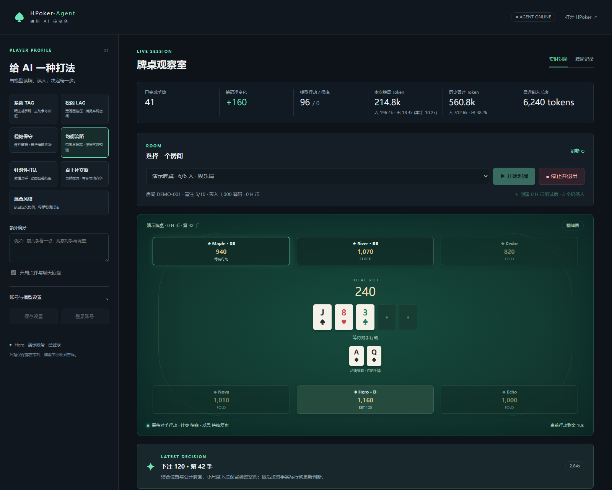
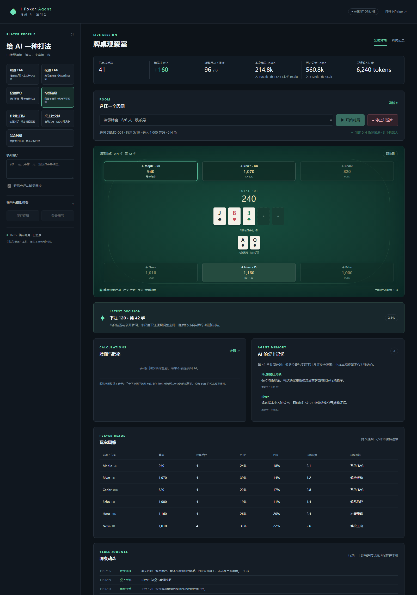

<div align="center">

# ♠ HPoker-Agent

**让 AI 坐上牌桌：观察、决策、交流与复盘。**

为 [HPoker](https://github.com/HBZHSN/HPoker) 构建的本地德州扑克 AI 控制台。<br>
连接支持工具调用的 OpenAI 兼容模型接口，在一个页面里管理打法、房间与牌局记忆。


[界面预览](#界面预览) · [快速开始](#快速开始) · [配置与隐私](#配置与隐私) · [运行细节](docs/behavior.md)

</div>

## 界面预览



<p align="center"><sub>真实前端界面，使用合成演示数据；玩家、牌局和统计均为虚构，不代表实测收益。</sub></p>

<details>
<summary><b>查看玩家画像、共同计划与牌桌日志</b></summary>



</details>

## 可以做什么

| 能力 | 实际体验 |
| --- | --- |
| **三类 Agent 协作** | 对局负责操作，社交回应公开聊天，反思持续复盘；模型请求与任务独立运行 |
| **可选择的打法** | 紧凶、松凶、保守、均衡、针对性、社交；支持按权重每手混合与额外偏好 |
| **牌桌控制** | 登录、选择房间、开始、停止离座；可创建 0 H 币且带 3 个机器人的娱乐测试房 |
| **持续观察** | 拼接服务端最近行动，展示牌面、筹码、VPIP、PFR、侵略系数与样本数量 |
| **持久记忆** | SQLite 保存可见牌局、玩家印象、共同计划与记忆修改审计，按服务器和账号隔离 |
| **决策可追踪** | 查看模型操作与理由、耗时、Token 用量、保底操作及历史牌局 |

手动计算器提供权益、候选 outs 与跟注赔率，结果只供用户查看。对局模型根据原始局面自行判断，客户端校验合法行动、丢弃过期决策，超时使用 check / fold 保底。

## 快速开始

需要 **Python 3.11+**、可访问的 HPoker 服务和支持工具调用的模型服务。

```powershell
git clone https://github.com/HBZHSN/HPoker-Agent.git
cd HPoker-Agent
python -m venv .venv
.venv\Scripts\python -m pip install -r requirements.txt
Copy-Item config.example.json config.local.json
```

编辑 `config.local.json`，填入自己的服务地址、模型 ID、账号和凭据，再启动：

```powershell
.venv\Scripts\python app.py
```

打开 **[http://127.0.0.1:8766](http://127.0.0.1:8766)**，选择打法 → 登录账号 → 选择房间 → 开始对局。macOS / Linux 将 Python 路径替换为 `.venv/bin/python`，使用 `cp` 复制配置。

停止时会取消模型任务并请求离座。服务端不允许在全下、RIT 或摊牌中立即退出时，控制台会显示等待状态并继续重试，详情见[运行行为](docs/behavior.md)。

## 配置与隐私

| 字段 | 填写内容 |
| --- | --- |
| `server_url` | 你的 HPoker HTTP(S) 服务地址；示例域名不能用于连接 |
| `model_url` / `model` | 模型 API 根地址（通常以 `/v1` 结尾）和服务实际提供的模型 ID |
| `proxy_url` | HPoker REST / WebSocket 使用的 HTTP(S) 代理；默认示例为本机 `7897` 端口，需自行配置并启动 |
| `username` / `password` | HPoker 账号与密码 |
| `api_key` | 模型服务凭据；模型请求不经过 `proxy_url` |

当前模型请求携带 `thinking_token_budget` 等思考参数，模型后端需要支持；切换后端前请检查 [agent.py](agent.py) 中的请求参数。

也可用进程环境变量覆盖凭据（不自动读取 `.env` 文件）：

```powershell
$env:POKER_PASSWORD = "your-password"
$env:POKER_MODEL_KEY = "your-api-key"
.venv\Scripts\python app.py
```

- `master` 仅包含代码、空凭据示例、文档与合成数据截图。
- 真实地址和凭据放在 **`config.local.json`**；该文件、`.env*`、原始本地需求、`data/`、数据库和日志均被 Git 忽略，无需建立含密分支。
- 配置接口不返回密码或 API Key，模型输入不包含凭据；页面密码 / Key 留空会保留已有值。在页面保存配置会将当前凭据写入本地配置文件。
- 控制台只监听 `127.0.0.1`，校验 Host / Origin。配置与牌局数据以明文保存在本机；模型服务仍会收到决策所需的牌局与相关记忆。

## 项目结构

```text
HPoker-Agent/
├── app.py                 # 本地 API、配置与控制台入口
├── agent.py               # 牌桌连接、对局 / 社交 / 反思任务
├── prompts.py             # 预设风格与模型工具提示
├── poker_math.py          # 手动牌型与权益计算
├── storage.py             # SQLite 历史、画像、记忆与审计
├── static/                # 无前端构建步骤的控制台
├── tests/                 # 离线单元测试与 API 回归
├── docs/                  # 运行细节与界面截图
└── config.example.json    # 可公开的配置模板
```

## 验证

```powershell
.venv\Scripts\python -m unittest discover -s tests -v
node --check static/app.js
```

测试使用临时数据库与模拟接口，覆盖行动校验、上下文裁剪、账号隔离、并发任务、超时保底、离座和配置隐私；无需真实账号或连接牌桌。测试通过与演示截图均不代表实桌稳定性或策略收益。
